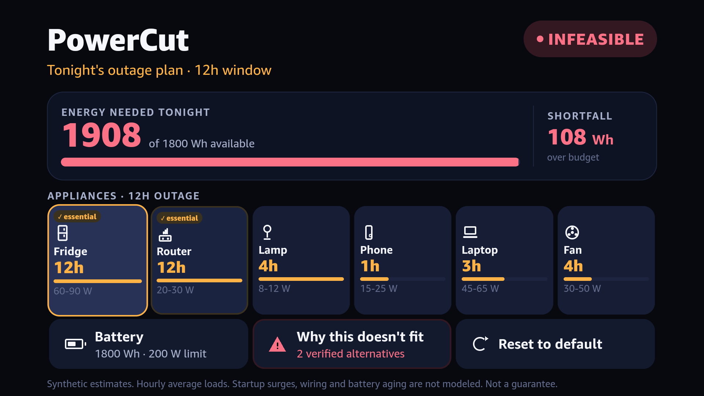
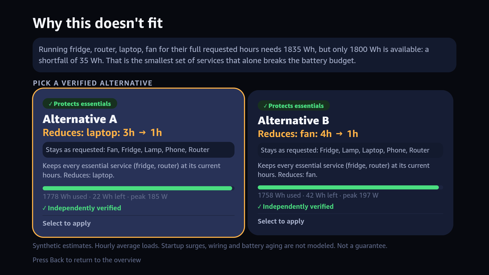
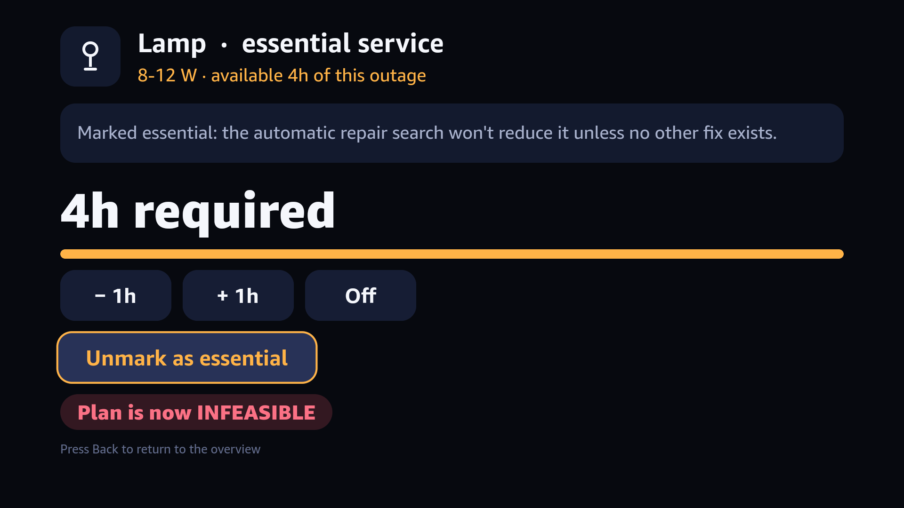
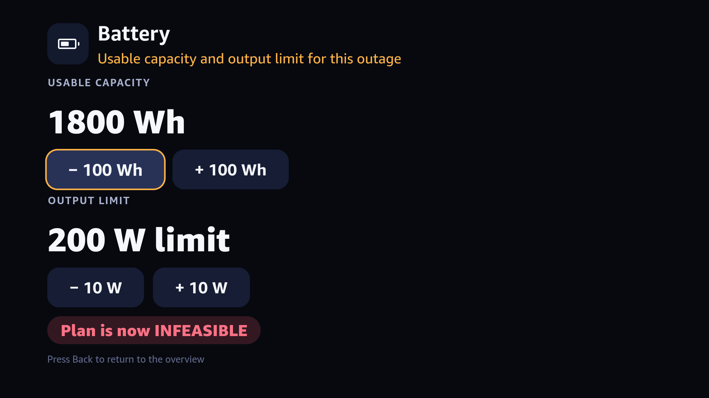
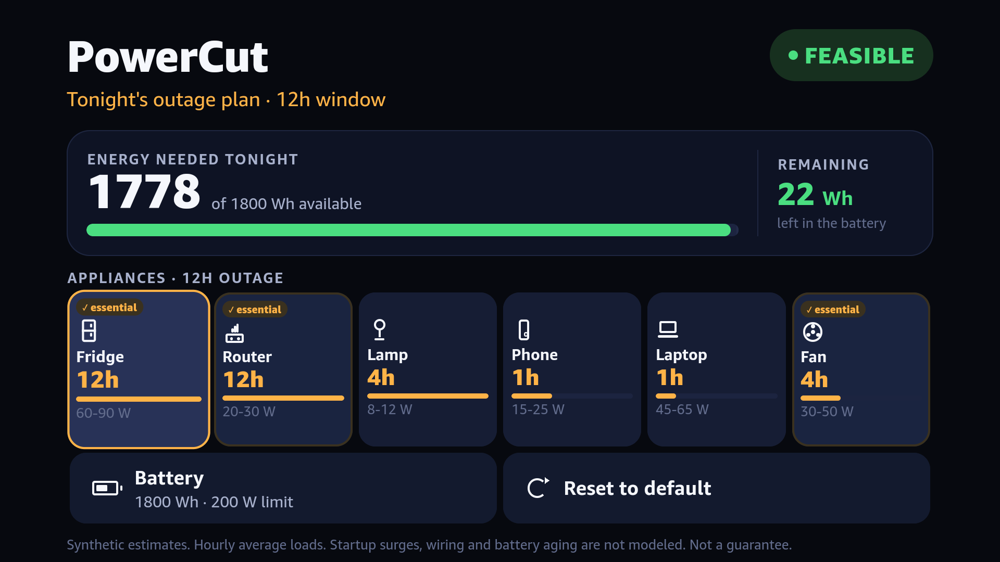

# PowerCut

PowerCut is a Fire TV app for planning a household's battery use during a
12-hour outage. A deterministic constraint engine schedules six appliances,
explains infeasible requests, and offers independently verified alternatives
that protect the household's selected essential services whenever possible.

Built for the Amazon Build, Ship, Shape 2026 Hackathon on React Native for
Vega. The production engine runs locally in the app: no server, network
connection, or precomputed answer is required.

<p align="center">
  
  
</p>

## Product walkthrough

1. The overview shows requested runtime, essential-service status, usable
   battery energy, and output limits.
2. A D-pad opens any appliance or battery setting. Each confirmed edit
   recomputes the complete plan.
3. If the request cannot fit, PowerCut explains the binding constraint and
   searches for up to two minimum-sacrifice, one- or two-appliance repairs.
4. Alternatives are labeled `Protects essentials` or `Requires compromise`,
   independently verified, and can be applied from the remote.

The shortest demonstration path is: launch the default infeasible plan, set
the laptop from 3h to 1h, confirm the feasible plan, set the fan from 4h to
5h, compare the two repairs, and apply Alternative A. The detailed shot list
is in [`docs/DEMO_VIDEO_STORYBOARD.md`](docs/DEMO_VIDEO_STORYBOARD.md).

<p align="center">
  
  
  
</p>

These are screenshots from the Vega Virtual Device, not desktop mockups.
More captured device evidence is under [`evidence/screenshots/`](evidence/screenshots/).

## Architecture

```text
Fire TV remote
      │
      ▼
React Native UI (src/App.tsx)
      │  validated household state
      ▼
In-app TypeScript engine (src/engine/)
      ├── exact dynamic-programming solver
      ├── solver-independent schedule verifier
      ├── essentials-aware repair search
      └── explanation and response assembly

Python reference (engine/ + backend/)
      │  generates expected outputs
      ▼
231-scenario differential fixture ──► Jest compares TypeScript field-for-field
```

The shipped path is entirely TypeScript. The dependency-free Python engine is
kept as an independent oracle, not as a runtime service. Nondeterministic
metadata and implementation-specific counters are the only fields excluded
from differential comparison. The solver, verifier, and repair boundaries are
documented in [`docs/ENGINE_PORT.md`](docs/ENGINE_PORT.md).

### Correctness boundaries

- Scheduling is exact within one-hour bins and the declared appliance windows.
- The verifier independently checks identity, runtime, hourly power, and energy
  for every returned schedule.
- Repair search is exhaustive and minimum-sacrifice within its declared scope:
  changing one or two appliances. It does not invent a repair when three or
  more simultaneous changes would be required.
- Repair ordering has a deterministic appliance-id tiebreaker and is tested
  across Python hash seeds.
- The TypeScript production engine is compared against the Python oracle over
  21 fixed and 210 seeded-random scenarios, including 67 cases that vary the
  household's essential-service selection.

## Evidence

### Current host-runnable checks

| Layer | Checks | Command |
|---|---:|---|
| React Native UI | 21 | `npm run test:ci` |
| TypeScript/Python differential | 232 | `npm run test:ci` |
| Forced-compromise execution budget | 1 | `npm run test:ci` |
| Python reference server | 12 | `python3 backend/test_server.py` |
| Python solver and verifier | 16 | `python3 engine/run_experiment.py` |
| Python repair search | 14 | `python3 engine/test_repairs.py` |
| **Total** | **296** | |

The 232 differential checks are 231 generated scenarios plus one fixture
sanity check. GitHub Actions runs TypeScript, lint, Jest, all Python suites,
regenerates the oracle fixture, and fails if the committed fixture has drifted.
It deliberately does not claim to build or test the proprietary Vega runtime.

```bash
npm ci
npm run typecheck
npm run lint       # 0 errors; the current baseline includes 34 warnings
npm run test:ci

python3 backend/test_server.py
python3 engine/run_experiment.py
python3 engine/test_repairs.py
python3 engine/differential/generate_cases.py
git diff --exit-code -- test/fixtures/differential-cases.json
```

Historical reports retain the counts measured at their phase. The reconciliation
between those milestones and the current 296 checks is in
[`docs/QUALITY_SPRINT.md`](docs/QUALITY_SPRINT.md).

### Vega Virtual Device evidence

The existing release-build benchmark report records the following on-device
measurements. These are historical Vega Virtual Device results, not Node or
desktop timings:

| Scenario | Median | p95 | Max | n |
|---|---:|---:|---:|---:|
| `defaultConfig()` | 0ms | 0ms | 0ms | 10 |
| Feasible plan, laptop = 1h | 1ms | 2ms | 2ms | 10 |
| Default infeasible plan | 43ms | 182ms | 182ms | 10 |
| Forced-compromise path, before duplicate-work optimization | 2056ms | 2104ms | 2104ms | 10 |

The optimization reduced deterministic solver work on the forced-compromise
plan from 770 to 629 calls (18.3%). A noisy follow-up device session did not
establish a wall-clock improvement, so none is claimed. The complete method,
raw runs, and same-session control are preserved in
[`docs/ENGINE_BENCHMARKS.md`](docs/ENGINE_BENCHMARKS.md).

## Expensive-path finding

`src/api.ts` yields one macrotask before starting a plan calculation. That lets
the press feedback render first, but it does **not** make the synchronous
calculation interruptible. The forced-compromise regression now locks the full
path to its known output and 629-call work budget.

No new concurrency mechanism was added in this sprint:

- Amazon's Web Worker guidance applies to web apps inside Vega WebViews, not
  this React Native application.
- Vega Turbo Modules can explicitly move native work off the JS thread, but
  that would introduce a native implementation and a new device-compatibility
  surface for a small deterministic TypeScript engine.
- Cooperative chunking is the least invasive future direction, but it requires
  a resumable search state, cancellation for stale UI requests, deterministic
  ordering tests, and release-build device evidence before it can be called a
  UI-blocking fix.

The decision record and official platform references are in
[`docs/QUALITY_SPRINT.md`](docs/QUALITY_SPRINT.md).

## Build and run

Host tests require Node 20+ and Python 3.9+; the Python engine uses only the
standard library.

Vega device work requires Amazon's Vega SDK and Virtual Device environment:

```bash
npm ci
npm run build:release
```

The repository's device setup notes and known SDK friction are in
[`docs/VEGA_SDK_FRICTION_LOG.md`](docs/VEGA_SDK_FRICTION_LOG.md). Host CI is
not a substitute for a release build and interaction test on that runtime.

## Explicit limitations

- Loads use constant bounded watts in one-hour bins; startup surges, battery
  aging, reserve selection, wiring safety, charging, and solar input are not
  modeled.
- This is a planning aid, not an electrical-safety guarantee.
- Automatic repairs change at most two appliances.
- The rare forced-compromise path remains expensive and synchronous once it
  starts. The app has device evidence for the existing behavior, but no new
  claim that this sprint eliminated JS-thread blocking.
- Device performance depends on release builds and hardware. Node/Jest timing
  is useful for reproduction, not a Vega performance measurement.

## Repository map

```text
src/engine/       Shipped TypeScript solver, verifier, and repair search
src/App.tsx       D-pad UI and household editing flow
engine/           Independent Python reference and adversarial tests
backend/          Reference HTTP wrapper and validation tests
test/             UI, differential, and execution-budget regressions
docs/             Design decisions, benchmarks, protocols, and phase reports
evidence/         Captured Vega Virtual Device screenshots
.github/workflows Host-only continuous integration
```

PowerCut is licensed under the [MIT License](LICENSE).
